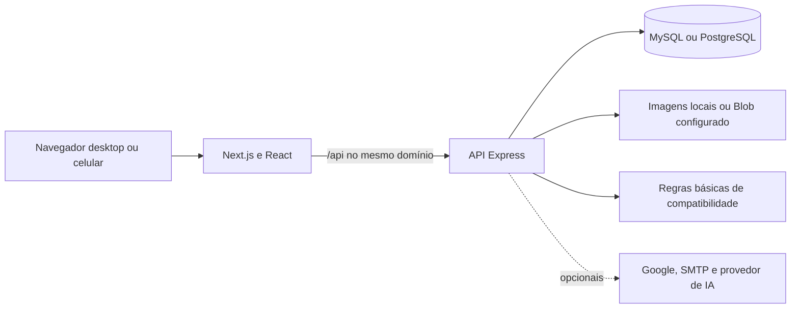

# Apresentação do TCC EHtech

Roteiro de demonstração da versão acadêmica revisada em 10/11/2026. A EHtech reúne anúncios de tecnologia e serviços de usuários, com moderação, negociação registrada e acompanhamento. Os resultados executados e as limitações estão em [CHECKUP.md](CHECKUP.md). A demonstração deve usar contas e ofertas fictícias.

## Preparação

1. Siga o [README](../README.md) para instalar e configurar o ambiente. Reutilize a instância existente; não inicie outro servidor nas portas 3000/3001. Na máquina de apresentação já configurada, inicie o banco utilizado e execute `npm run dev`. Para servir a compilação, use `npm run build` e depois `npm run start:all`.
2. Confira `/api/health` e abra início, produtos, serviços e compatibilidade. A saúde verifica o banco; uma página inicial carregada sozinha não comprova que a API funciona.
3. Prepare três sessões separadas: comprador, vendedor/prestador e administrador. Use perfis distintos do navegador. Cadastre contas comuns válidas e promova somente a conta administrativa pelo comando documentado no README. Não mostre senhas, tokens, ambientes privados ou ferramentas de banco no projetor.
4. Prepare um produto fictício pendente, um aprovado com estoque e origem cadastrada, e um serviço aprovado com descrição, entregáveis e critérios de aceite. Comprador e vendedor devem ser contas diferentes. Não execute seeds em base com dados reais.
5. Deixe um pedido de demonstração e uma contratação já existentes como alternativa caso o tempo da banca seja curto. Mantenha capturas locais das telas e o relatório de testes disponíveis para falha de rede.
6. Teste o computador/projetor e o tamanho da janela. Google, SMTP e IA externa dependem de configuração e rede; o login comum e as regras básicas de compatibilidade permitem demonstrar o núcleo sem esses provedores.

## Roteiro sugerido de 12 minutos

| Tempo | Demonstração | O que comprovar |
| --- | --- | --- |
| 0–1 min | Problema e proposta | Centralizar ofertas e serviços, com responsáveis identificados e negociação registrada |
| 1–2 min | Início e catálogo | Pesquisa, categoria, preço, paginação, temas e acesso pelo celular |
| 2–4 min | Anúncio e administração | Usuário publica; anúncio pendente depende de aprovação para entrar na vitrine |
| 4–7 min | Compra e recebimento | Carrinho, endereço revisado, frete a combinar, pedido sem cobrança, proposta e aceite; vendedor disponibiliza retirada, comprador gera código após receber e vendedor confirma |
| 7–9 min | Serviços da comunidade | Prestador identificado, solicitação, orçamento, aceite e execução; usar contratação preparada para mostrar conclusão e garantia registrada |
| 9–10 min | Diferenciais | Compatibilidade básica explicável sem IA; selecionar modelos cobertos pelas fichas revisadas e mostrar os limites das regras |
| 10–11 min | Segurança e confiança | Avaliação de compra verificada, denúncia, propriedade dos dados e visão restrita do vendedor |
| 11–12 min | Arquitetura e evidências | Next/React, API Express, MySQL/PostgreSQL, testes reais e limites da versão |

Durante a retirada, mantenha as duas sessões abertas no mesmo pedido. Após cada ação da outra pessoa, use **Atualizar pedido**. Informe o código somente depois do recebimento simulado. Para encurtar, demonstre um pedido previamente acordado e explique as etapas anteriores.

## Demonstração dos diferenciais documentados

Se a banca pedir detalhes adicionais, use os seguintes caminhos. As jornadas estão em `tests/e2e/documented-features.spec.cjs` e funcionam com dados fictícios isolados, sem serviço pago.

- **Passaporte:** em `/passaportes`, cadastre equipamento e componentes, adicione manutenção, exporte a ficha e ative consulta pública. Na transferência, informe o username da outra conta; ela aceita o convite e o link público anterior é revogado.
- **Missões:** em `/missoes`, escolha objetivo e orçamento. Explique as três faixas, as lacunas e a ausência de estimativa de desempenho/consumo quando não há dados.
- **Combos:** em `/combos`, a mesma conta associa seu produto aprovado ao serviço ativo próprio. A referência soma os preços conhecidos; a compra do produto e o orçamento do serviço continuam separados.
- **Serviço e inspeção:** envie orçamento em `/contratacoes`, aceite como cliente e conclua como prestador. O cliente pode avaliar e conferir a garantia registrada. Para `/certificados`, vincule o atendimento concluído ao passaporte e selecione um anúncio próprio aprovado. O prestador daquele atendimento responde checklist e laudo; somente então o anúncio apresenta o selo válido. Não represente esse laudo declarado como certificação oficial.

## Arquitetura para explicar à banca

O frontend apresenta as opções; o servidor valida identidade, propriedade, preços e etapas. O banco preserva os registros e as condições aceitas. As integrações opcionais não substituem as regras básicas nem autorizam operações. As consultas usam parâmetros e o adaptador mantém a interface SQL nos dois bancos.

## Escopo demonstrável e limites

| Disponível nesta versão | Limite a explicar |
| --- | --- |
| Produtos, serviços, moderação e negociação | Aprovação não certifica identidade civil nem qualidade |
| Pedido, frete negociado, envio/retirada e recebimento | Não processa pagamento, não reserva/baixa estoque e não integra rastreamento de transportadora |
| Código temporário de retirada e confirmação direta | Confirmação é declaração de recebimento; não comprova pagamento ou qualidade |
| Denúncias e decisões administrativas | Não há disputa bilateral com anexos, estorno ou garantia financeira automática |
| Contratação, orçamento, etapas e garantia registrada | Garantia é registro das condições do prestador, sem seguro ou pagamento integrado |
| Catálogo e regras básicas de compatibilidade | Dados ausentes permanecem não verificados; não certifica uma montagem completa |
| Complemento opcional com IA | Pode estar indisponível; não substitui fontes e especificações técnicas |
| Interface responsiva e testes Chromium | Viewport de celular não equivale a homologação em aparelhos físicos ou todos os navegadores |
| Anúncios digitais | Cofre privado de arquivos e transferência verificada de contas permanecem futuros |

Não apresente itens do [escopo posterior](ESCOPO_MARKETPLACE_SERVICOS_E_DIGITAIS.md) como concluídos. Não atribua à versão atual resultados históricos sem data. Não afirme capacidade de produção, certificação de acessibilidade ou segurança integral com base apenas na suíte automatizada.

## Evidências e perguntas esperadas

- **Como evitar pedido duplicado?** A mesma sessão identifica o pedido registrado; a interface recupera a confirmação após resposta perdida e o servidor preserva a idempotência.
- **Quem altera uma entrega?** O servidor determina o papel pelo usuário e pelo pedido, exige versão e recusa ação fora de etapa. Vendedores veem somente seus grupos.
- **Como o login lida com concorrência?** Contadores persistentes limitam tentativas entre instâncias; conflitos transacionais têm repetição limitada e falha persistente impede autenticação.
- **Como comprovar os testes?** Mostrar resultados datados do CHECKUP e o documento oficial de testes. Logs, relatório HTML e capturas geradas ficam em `scratch/`, fora do Git.
- **O que evoluir depois?** Entrega privada de digitais, disputa bilateral, autenticação reforçada e operação comercial exigem escopo e validação próprios. Não há contratação automática de serviço pago.

As referências de requisitos estão na [ERS oficial](https://sesisenaispedu-my.sharepoint.com/:w:/g/personal/emanuel_silva4_portalsesisp_org_br/IQDY-Z3bcue6TpogbqxR0i0CAb6n5HYvtQrNDpcu7PP5ZV4?e=kHKttO), com preservação do histórico. O [documento oficial de testes](https://sesisenaispedu-my.sharepoint.com/:w:/g/personal/emanuel_silva4_portalsesisp_org_br/IQBkk7VCCxB6S6uGZ2P-DF3FAXd_EBs-4wCFvS91PJ68WG0?rtime=XeTr17o130g) registra cenários e situações reais por versão.
